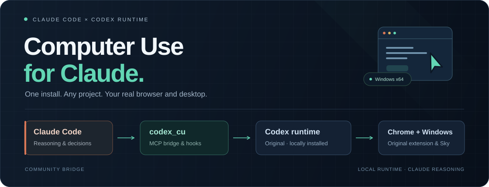

<p align="center">
  
</p>

<h1 align="center">Codex Computer Use for Claude</h1>

<p align="center">
  <strong>Claude 负责思考，Codex 原版运行时负责操作电脑。</strong><br>
  在 Claude Code 中使用 OpenAI 原版 Chrome 扩展与 Windows 桌面能力。
</p>

<p align="center">
  
  
  
  
</p>

<p align="center">
  <a href="#快速开始">快速开始</a> ·
  <a href="#能做什么">能做什么</a> ·
  <a href="#授权与会话">授权与会话</a> ·
  <a href="#常见问题">常见问题</a> ·
  <a href="docs/verification.md">验证记录</a>
</p>

---

一次安装，以后在任意项目运行 `claude` 即可。浏览器沿用原版 Chrome 扩展和现有登录状态，桌面操作使用本机原版 Windows 运行时；桥接本身不调用 Codex 模型。

> **当前支持：Windows x64 + Claude Code。** 社区非官方项目。macOS、Linux、Windows ARM64、Claude Desktop 和其他宿主尚未适配或验收。

## 快速开始

### 1. 准备环境

| 依赖 | 要求 |
| --- | --- |
| Windows | x64；桌面操作时保持解锁 |
| [Node.js](https://nodejs.org/) | 22 或更高版本，`node`、`npm` 可用 |
| Claude Code | 已安装并登录 |
| Codex 桌面应用 | 已安装，**使用期间保持运行** |
| 原版浏览器能力 | 在 Codex 中启用 Computer Use / Chrome 插件，并安装 OpenAI 原版 Chrome 扩展 |

### 2. 安装一次

在 PowerShell 中运行：

```powershell
git clone https://github.com/patrickleehua/computer-use-for-claude.git
cd computer-use-for-claude
.\install.ps1
```

安装器将独立软件包安装到 npm 全局目录，并注册 Claude **用户级** MCP 与 hooks。安装完成后可以移动源码目录；已有 Claude 会话需要重新启动。

### 3. 在任意项目使用

```powershell
cd D:\your-project
claude
```

在 Claude 中直接说：

> 使用 codex_cu 打开 YouTube，让我看到页面。

> 使用 codex_cu 打开这个 GitLab Job 链接，读取失败日志，分析 CI 报错原因。

> 使用 codex_cu，通过记事本界面打开指定测试文件，输入“你好，Windows ✅”并保存。

安装后日常使用无需再运行 `start.ps1`。可在 Claude 的 `/mcp` 中检查 `codex_cu` 是否已连接。

## 能做什么

| 场景 | 实际行为 |
| --- | --- |
| **打开看得见的网页** | 选择结果标签、恢复并聚焦窗口，核对其可见状态，避免只在后台“打开成功” |
| **读取已登录的网站** | 通过原版 Chrome 扩展操作现有浏览器，可进入 GitLab 项目、失败 Job 和日志 |
| **多轮继续操作** | 同一 Claude 会话复用运行时连接；下一条消息继续使用原页面 |
| **保留结果页面** | 标记为交付结果的网页在回合结束和桥接退出后仍保留 |
| **操作 Windows 应用** | 通过原版 `@oai/sky` 观察、输入和点击，保留文件对话框等界面的多张截图 |
| **中止后继续新任务** | 停止旧轮，清理失效内核绑定；新轮重新观察，不自动重放输入或保存 |

这些能力的实测环境、证据层次与遗留限制见 [验证记录](docs/verification.md)。

## 如何工作

```text
Claude Code                         负责理解任务、推理和决策
    │
    ▼ MCP + Claude hooks
codex_cu                            转发工具、同步权限和回合生命周期
    │
    ▼ 本机已安装的原版运行时
OpenAI / Codex Computer Use
    ├── 原版 Chrome 扩展             浏览器页面、现有登录状态
    └── 原版 Windows @oai/sky         原生窗口、键鼠、截图
```

运行时与操作文档从本机安装元数据中发现。本项目不分发 OpenAI 二进制，不安装替代桌面驱动，不修改 Codex 内部文件、扩展、Native Messaging 注册、浏览器 Profile 或 Cookies。

<details>
<summary><strong>提供给 Claude 的工具</strong></summary>

| 工具 | 用途 |
| --- | --- |
| `open_browser` | 打开或恢复网页；确认可见后返回 `presented: true`，标记保留后返回 `retained: true` |
| `js` | 使用原版运行时 JavaScript API 读取和操作浏览器 |
| `desktop` | 先读取本机原版文档，再在同一内核中使用 `@oai/sky` 操作 Windows 应用 |
| `js_reset` | 重置共享 JavaScript 内核 |

调用身份与回合结束由 Claude hooks 同步；内部宿主工具不供模型自行调用。

</details>

## 授权与会话

桥接读取**每次调用时 Claude 的实际权限模式**，不修改你的默认模式，也不保存长期访问授权。

| Claude 模式 | 普通网站、低风险应用访问 |
| --- | --- |
| `auto` / `bypassPermissions` | 自动应答，普通连续操作无需反复确认 |
| `manual` / `default` / `acceptEdits` / `plan` | 保留交互确认；计划模式的执行限制仍由 Claude 控制 |
| `dontAsk` | 需要额外授权时取消，不弹框 |
| 未知或缺失模式 | 回退到交互确认 |

手动授权框中，**Accept** 允许本次、**Decline** 拒绝、**Esc** 取消。其他动作确认、数据表单和原版策略拒绝继续生效。

**Chrome 的“正在控制”提示消失，表示本轮接管结束。** MCP 与运行时连接可供同一 Claude 会话的下一轮继续使用；保留的结果页不会因此关闭。临时调研页遵循原版回合清理。

## 命令速查

| 命令 | 用途 |
| --- | --- |
| `codex-cu --version` | 查看桥接版本 |
| `codex-cu status` | 查看用户级接入状态 |
| `codex-cu doctor` | 检查原版运行时能否连接；不等同于界面验收 |
| `codex-cu install` | 重新注册用户级 MCP 与 hooks |
| `codex-cu uninstall` | 移除本桥接的用户级注册，保留其他配置 |
| `codex-cu setup <目录>` | 可选：仅为指定项目接入 |
| `codex-cu remove <目录>` | 移除指定项目的桥接注册与 hooks |

**升级：** 在更新后的源码目录重新运行 `.\install.ps1`。

**卸载：** 先移除 Claude 接入，再卸载软件包。

```powershell
codex-cu uninstall
npm uninstall --global codex-computer-use-for-claude-windows
```

## 常见问题

<details>
<summary><strong>安装后 Claude 里没有工具，或仍提示 Disabled？</strong></summary>

先重启 Claude，再运行 `codex-cu status` 并检查 `/mcp`。安装器保留项目对同名服务的显式禁用或覆盖；若显示 Disabled，按需选择 Enable。

从旧的项目级接入迁移到用户级时，在那个项目运行：

```powershell
codex-cu remove .
```

它只移除本桥接的项目注册与 hooks，其他项目配置保留。使用 `--strict-mcp-config` 或通过 `--setting-sources` 排除用户设置，也会屏蔽用户级接入。

</details>

<details>
<summary><strong>只想在一个项目使用，可以吗？</strong></summary>

可以。在源码目录运行 `start.ps1`，或指定项目：

```powershell
.\start.ps1 -Project 'D:\your-project'
```

已安装全局命令时，也可用 `codex-cu setup 'D:\your-project'`。日常跨项目使用建议按快速开始安装用户级接入。

</details>

<details>
<summary><strong>需要 Codex 模型吗？数据会发到哪里？</strong></summary>

桥接只调用本机原版 Computer Use 运行时，不发起 Codex 模型请求。推理由 Claude Code 承担，截图与界面文字可能发送到你为 Claude 配置的模型提供方。Codex 应用及原版组件仍需满足各自的账户、使用条件和许可。

</details>

<details>
<summary><strong>配置和诊断日志在哪里？</strong></summary>

用户级 MCP 通过 Claude 官方 CLI 注册；hooks 写入 `~/.claude/settings.json`。设置 `CLAUDE_CONFIG_DIR` 时跟随该独立配置目录。注册与移除按合并方式保留其他配置；遇到冲突、格式错误或并发改动时停止。

诊断日志默认在 `%LOCALAPPDATA%\codex-cu\logs`，记录版本、耗时、图片数量、授权回应和清理状态，不记录页面内容、代码或截图。

| 环境变量 | 用途 |
| --- | --- |
| `CODEX_CU_LOG` | 指定诊断日志文件路径 |
| `CODEX_HOME` | 指定现有 Codex 数据目录 |
| `CLAUDE_CONFIG_DIR` | 使用独立的 Claude 配置目录 |

参考 Claude 官方文档：[MCP 配置作用域](https://code.claude.com/docs/en/mcp) · [Hooks](https://code.claude.com/docs/en/hooks)。

</details>

## 验证与开发

已验证：真实 Claude 调用原版扩展、网页可见与保留、同进程四轮续用、取消恢复、记事本新文件保存、真实 GitLab CI 只读诊断，以及两个全新目录中的用户级安装。

当前有 **31 项自动回归测试**。真实界面验证和自动测试的范围分别记录在 [验证记录](docs/verification.md)，不将自动测试数量视为完整界面验收。

```powershell
npm ci
npm test
node scripts/test-site.mjs
```

本地测试页只监听 `127.0.0.1`，启动时打印实际地址；数据写入被 Git 忽略的 `.local/`。目前从源码安装，软件包尚未发布到 npm registry。

## 当前边界

- **仅 Windows x64 + Claude Code。** 其他平台和宿主未适配或验收。
- **桌面操作需要前台和解锁状态。** 原版对部分既有最小化窗口存在观察与激活相互阻塞。新文件任务可创建专用窗口；继续特定旧窗口或未保存文档时，不能擅自换目标。
- **先核对画面，再输入。** 原版偶尔返回与目标窗口不符的截图；须重新激活并观察一次，仍不符就停止操作。
- **人工授权 UI 验收仍受阻。** 实际授权协议与脚本宿主应答已验证，不代表真人终端按钮体验已完整通过。

---

<p align="center">
  <sub>社区非官方桥接 · Claude / Codex / OpenAI 为各自权利人的名称或商标 · 原版组件遵循其自身许可</sub>
</p>
